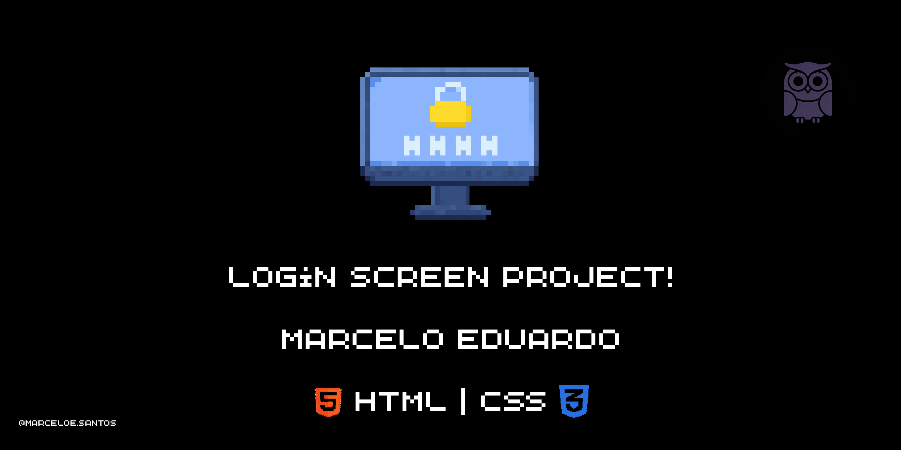
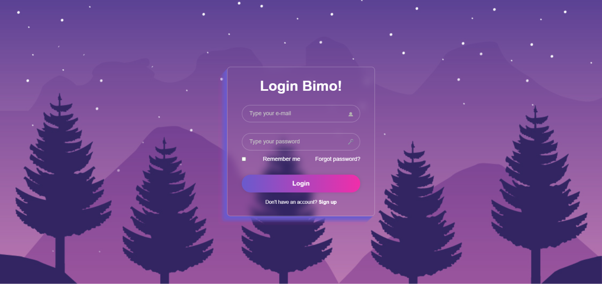

<div align="center">



# 🔐 Bimo Login

**Tela de login moderna com efeito glassmorphism, feita somente com HTML e CSS.**


</div>

---

## 📋 Índice

- [Sobre o projeto](#-sobre-o-projeto)
- [Preview](#-preview)
- [Funcionalidades](#-funcionalidades)
- [Design](#-design)
- [Tecnologias](#-tecnologias)
- [Estrutura do projeto](#-estrutura-do-projeto)
- [Como executar](#-como-executar)
- [Detalhes da implementação](#-detalhes-da-implementação)
- [Próximos passos](#-próximos-passos)
- [Contribuindo](#-contribuindo)
- [Licença](#-licença)
- [Autor](#-autor)

## 📖 Sobre o projeto

O **Bimo Login** é uma interface de autenticação com campos de e-mail e senha, opção "Remember me", link de recuperação de senha e atalho para cadastro. É um projeto **front-end estático**: não há validação de credenciais nem comunicação com servidor, pois o foco é o layout, a estilização e a estrutura semântica da página.

Foi criado para praticar:

- Construção de formulários em HTML
- Centralização de elementos com **Flexbox**
- Posicionamento de ícones dentro de inputs com `position: absolute`
- Efeito de vidro (**glassmorphism**) com `backdrop-filter`
- Gradientes, sombras e transições em CSS

## 🖼 Preview

<div align="center">
  
</div>

## ✨ Funcionalidades

- Campo de **e-mail** com ícone (`type="email"`)
- Campo de **senha** com ícone (`type="password"`)
- Checkbox **Remember me**
- Link **Forgot password?**
- Botão de **Login** com gradiente e efeito hover
- Link **Sign up** para quem ainda não tem conta
- Layout centralizado e responsivo (meta tag `viewport`)

## 🎨 Design

| Elemento | Detalhe |
|----------|---------|
| Fonte | Montserrat (com fallback para `sans-serif`) |
| Fundo | Imagem em tela cheia (`background-size: cover`) |
| Card | Transparente, com borda translúcida e `backdrop-filter: blur(10px)` |
| Largura do card | 420px |
| Inputs e botão | Formato arredondado (`border-radius: 40px`) |
| Sombra do card | Camadas em roxo, deslocadas para criar efeito de profundidade |
| Botão | Gradiente do roxo ao rosa; no hover, fica branco com texto preto |

### 🎨 Paleta de cores

| Cor | Código | Uso |
|-----|--------|-----|
| 🟣 Roxo (slate blue) | `#6A5ACD` | Início do gradiente do botão e sombra do card |
| 🌸 Rosa | `#F02EAA` | Fim do gradiente do botão |
| ⚪ Branco | `#FFFFFF` | Textos, links e hover do botão |
| 🔘 Cinza claro | `#C5C5C5` | Placeholder dos inputs |

## 🛠 Tecnologias

| Tecnologia | Uso |
|------------|-----|
| HTML5 | Estrutura e semântica da página |
| CSS3 | Estilização e layout |

## 📁 Estrutura do projeto

```
tela-de-login/
├── assets/
│   |── login_screen_project.png   # Banner / preview do README
|   |── demonstracao.png           # Demonstração do projeto
├── CSS/
│   └── styles.css                 # Estilos da página
├── HTML/
│   └── index.html                 # Página de login
├── img/
│   ├── background.png             # Imagem de fundo
│   ├── passwordicon.png           # Ícone do campo de senha
│   └── usericon.png               # Ícone do campo de e-mail
└── README.md
```

> O HTML e o CSS referenciam os recursos com caminhos relativos (`../CSS/styles.css` e `../img/`). Por isso, **mantenha as pastas nessa organização**, caso contrário o estilo, o fundo e os ícones não serão carregados.

## 🚀 Como executar

Não é necessário instalar nada.

**1. Clone o repositório**

```bash
git clone https://github.com/eduardomarcelo628-beep/tela-de-login.git
```

**2. Entre na pasta do projeto**

```bash
cd tela-de-login
```

**3. Abra a página no navegador**

- Abra o arquivo `HTML/index.html` com um duplo clique, **ou**
- Use a extensão **Live Server** no VS Code: clique com o botão direito em `index.html` e escolha **Open with Live Server**.

## 🔍 Detalhes da implementação

**HTML**

- Documento com `lang="pt-BR"` e textos da interface em inglês.
- Meta tag `viewport` para adaptação a diferentes telas.
- Ícones com atributo `alt` e checkbox associado ao `label` via `for` / `id`.
- O campo `type="email"` faz a validação básica de formato pelo navegador.
- Links "Forgot password?" e "Sign up" usam `href="#"` como espaço reservado.

**CSS**

- Reset global (`margin`, `padding` e `box-sizing: border-box`) aplicado com `*`.
- O `body` usa **Flexbox** para centralizar o card na vertical e na horizontal, com `min-height: 100vh`.
- Os ícones ficam posicionados dentro dos inputs com `position: absolute` e `transform: translateY(-50%)`.
- O `padding-right` dos inputs reserva espaço para o ícone não sobrepor o texto digitado.
- O botão usa `linear-gradient` e, no hover, uma `transition` de 0.5s suaviza a troca de cor.

**Observação sobre a fonte**

O CSS define `Montserrat`, mas o HTML não carrega essa fonte da web. Sem ela instalada no computador, o navegador usa a fonte `sans-serif` padrão. Para garantir a Montserrat em qualquer máquina, adicione no `<head>` do `index.html`:

```html
<link rel="preconnect" href="https://fonts.googleapis.com">
<link rel="preconnect" href="https://fonts.gstatic.com" crossorigin>
<link href="https://fonts.googleapis.com/css2?family=Montserrat:wght@400;600&display=swap" rel="stylesheet">
```

## 🗺 Próximos passos

- [ ] Carregar a fonte Montserrat via Google Fonts
- [ ] Adicionar validação com JavaScript
- [ ] Botão para mostrar/ocultar a senha
- [ ] Criar a página de cadastro (Sign up)
- [ ] Criar a página de recuperação de senha
- [ ] Ajustes de responsividade para telas pequenas com `@media`
- [ ] Integrar com um back-end para autenticação real

## 🤝 Contribuindo

Sugestões e melhorias são bem-vindas!

1. Faça um **fork** do projeto
2. Crie uma branch para sua feature: `git checkout -b minha-feature`
3. Faça o commit: `git commit -m "Adiciona minha feature"`
4. Envie para o GitHub: `git push origin minha-feature`
5. Abra um **Pull Request**

## 📄 Licença

Este projeto está sob a licença MIT. Consulte o arquivo `LICENSE` para mais detalhes.

## 👤 Autor

Feito por **Marcelo Eduardo**.

- GitHub: [@eduardomarcelo628-beep](https://github.com/eduardomarcelo628-beep)
- LinkedIn: [Marcelo Eduardo](https://www.linkedin.com/in/marcelo-eduardo-a03978246/)

<p align="center"> Desenvolvido com dedicação durante minha jornada de aprendizado em programação. ❤️👨🏽‍💻 </p>
